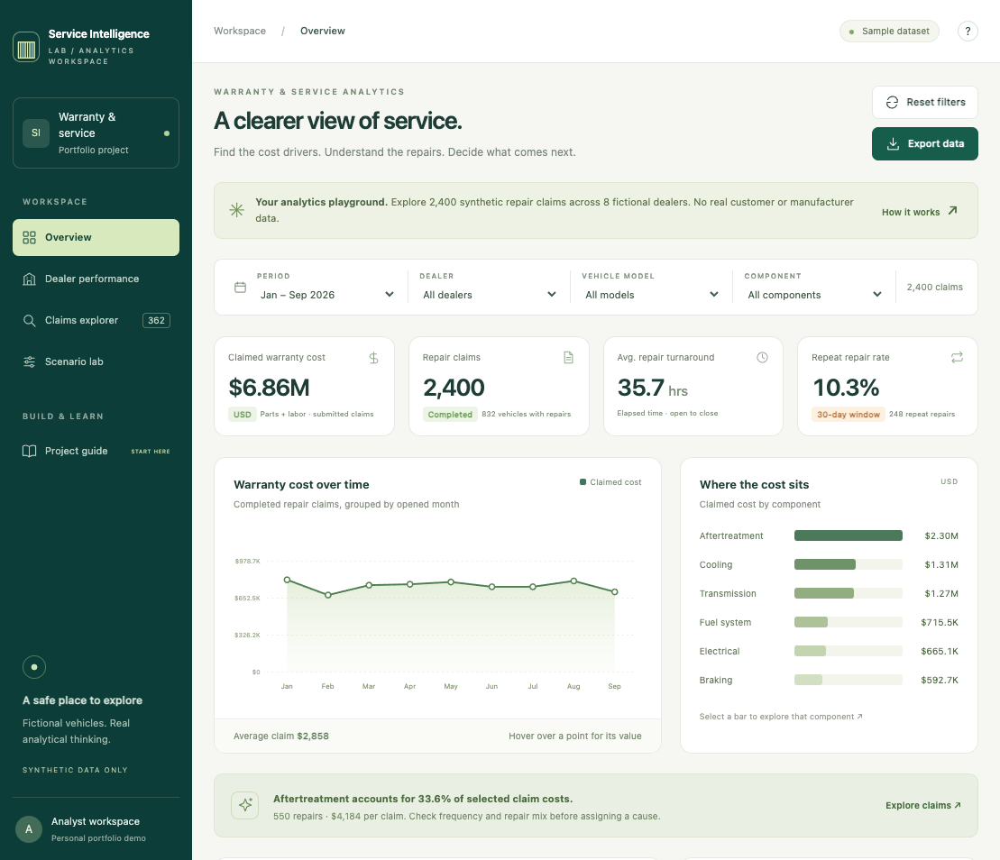
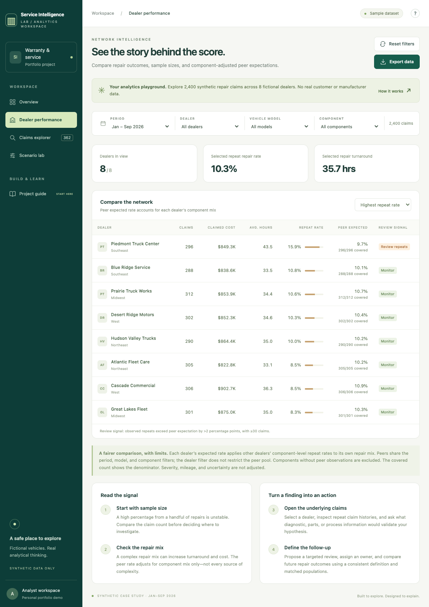
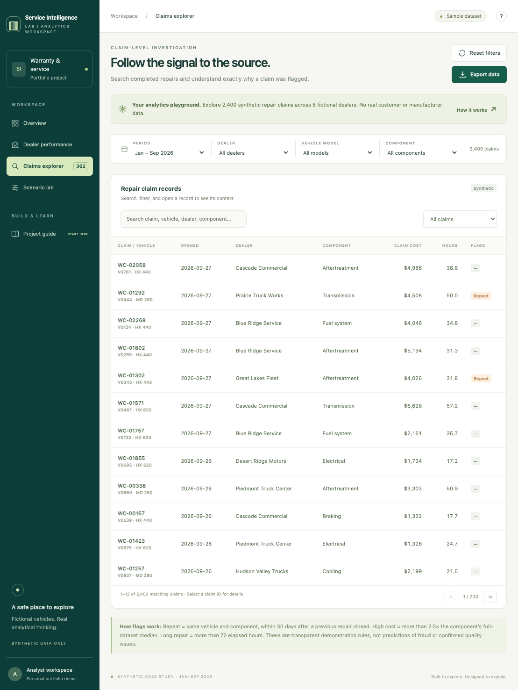
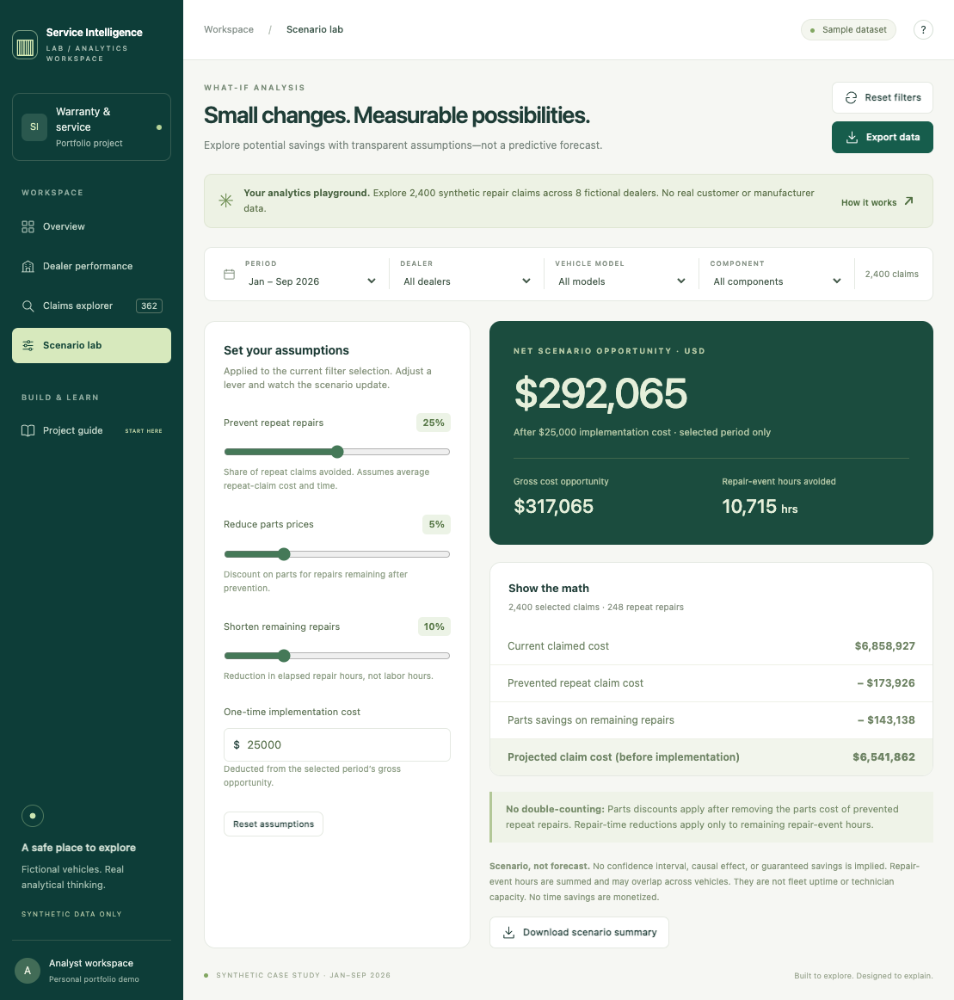
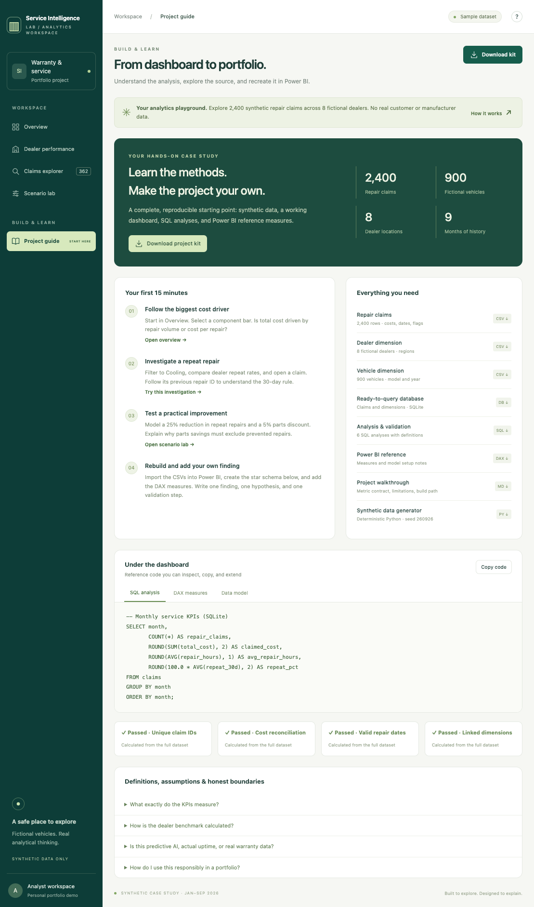

# Service Intelligence Lab

An interactive warranty and service analytics portfolio reference, using entirely synthetic data.
No affiliation with Volvo, Mack, any manufacturer, or any actual dealer. No production business results.

## Screenshots

These views are the working dashboard with the full synthetic dataset, January–September 2026.

### Overview

### Dealer performance

### Claims explorer

### Scenario lab

### Project guide

## Run and explore

Open the hosted app or serve the `dist` folder with `python -m http.server 8080 --directory dist`.
Visit http://localhost:8080. No API keys, dependencies, account integrations, or external chart libraries.
Use the filters, select a component bar, compare dealers, inspect claim records, and adjust scenarios.
The app keeps scenario controls in memory only. Reloading restores defaults. No user data is uploaded.

## Data and reproducibility

Run `python src/generate_data.py` to regenerate 2,400 claims, 900 vehicles, and 8 fictional dealers
with seed 260926. Data covers repair openings January–September 2026. Each claim is one completed
repair event. Claims are simulated, including planted cost outliers and cooling repair issues.
One vehicle can have multiple repairs. The dataset deliberately has no production ingestion pipeline.
`dist/downloads` contains flat CSVs and a SQLite database. `reference/analysis.sql` runs against it.

## Metric contract

| Metric | Definition and limitation |
|---|---|
| Claimed warranty cost | Sum of parts + labor, USD. Submitted amounts; not paid cost or reserves. |
| Average repair time | Mean elapsed hours between repair opening and closing. All records closed. |
| Repeat repair rate | Repairs with a prior closed repair for the same vehicle/component in the previous 30 days / repairs. |
| High-cost flag | Claim amount exceeds 2.5 times the component median in the complete synthetic dataset. |
| Long repair flag | Elapsed repair time exceeds 72 hours, an illustrative threshold. |
| Flagged claims | Unique claims meeting at least one flag. Multiple flags do not duplicate claims. |
| Component-mix peer rate | Apply other dealers' component-level repeat rates to a dealer's own component mix. |

Repeat flags use full available history before filters; January lacks pre-2026 history and may undercount repeats.
The component-mix benchmark uses the current period/model/component but intentionally ignores the dealer filter
for its peer pool. Components with no other-dealer observations are excluded from the expected rate and covered
volume is shown. Benchmark does not adjust for severity, mileage, vehicle age, region, or sample uncertainty.
Treat flags and dealer differences as investigation prompts, not fraud, causality, or statistical significance.
No uptime %, claim frequency per vehicle, predictive maintenance accuracy, or financial reserves are inferred.

## Scenario arithmetic

The what-if tool is a transparent scenario, not a forecast or ML model.
Let r be the selected fraction of repeat claims prevented, p the negotiated parts reduction,
and t the reduction in elapsed repair hours on remaining repairs.
Gross opportunity = repeat claim cost * r + (all parts cost - repeat parts cost * r) * p.
This avoids counting the prevented repair's parts twice. The model assumes prevented claims have average
repeat cost/parts/time. Elapsed repair hours avoided = repeat elapsed hours * r +
(all elapsed repair hours - repeat elapsed hours * r) * t. These are summed repair-event hours,
not technician labor hours or validated fleet uptime. No time savings are monetized.
Net scenario opportunity = gross opportunity - one-time implementation cost. All values apply only to
the selected period and filters. They are not annualized, confidence intervals, or proven savings.

## Power BI build path

1. Import claims.csv, dealers.csv and vehicles.csv.
2. Name tables FactClaims, DimDealer and DimVehicle. Set correct data types.
3. Create single-direction one-to-many relationships on dealer_id and vehicle_id.
4. Create the OpenDate column and DimDate calendar described in reference/measures.dax.
5. Add each DAX measure separately; format rates as percentages and costs as USD.
6. Recreate the four executive cards, monthly cost chart, component chart and dealer table.
7. Validate totals against the SQL queries before adding narrative conclusions.

The website is a working JS dashboard, not a PBIX file. DAX is provided as reference code and has not
been executed in a Power BI engine. SQL and scenario arithmetic are verified locally.

## Project structure

- dist/index.html, styles.css, app.js, analytics.js: working browser app
- dist/assets/data.json: generated data
- dist/downloads: CSV, SQLite, and reference kit
- src/generate_data.py: deterministic generation
- reference: SQL and DAX examples
- tests: data, scenario, and aggregation validation

Run checks with `python tests/validate_data.py` and `node tests/analytics.test.js`.
